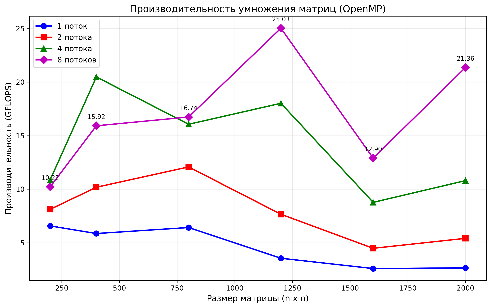

# Лабораторная работа №2: Параллельное умножение матриц (OpenMP)

## Описание

Параллельная реализация умножения квадратных матриц с использованием технологии OpenMP. Проведена серия экспериментов с различным числом потоков и размеров матриц.

## Конфигурация системы

- **Процессор:** Intel Core i5-13420H (13th Gen)
- **Архитектура:** гибридная (4 P-cores + 4 E-cores)
- **Физических ядер:** 8 (4 P-cores + 4 E-cores)
- **Логических потоков:** 12 (8 P-threads + 4 E-threads)
- **ОС:** Windows 11
- **Компилятор:** g++ 10.2.0 (MSYS2)
- **Флаги компиляции:** `-fopenmp -O2`
- **Тип данных:** `double`

## Методика эксперимента

- **Размеры матриц:** 200, 400, 800, 1200, 1600, 2000
- **Количество потоков:** 1, 2, 4, 8
- **Seed генератора:** фиксирован (`srand(42)`) для воспроизводимости
- **Замер времени:** `std::chrono::high_resolution_clock`
- **Производительность:** GFLOPS = 2·n³ / (time · 10)

## Проверка корректности

Сравнение с последовательной версией для матрицы 100×100:

- Результаты полностью совпадают — программа работает корректно

## Результаты экспериментов

### Производительность (GFLOPS)

| Размер | 1 поток | 2 потока | 4 потока | 8 потоков |
|--------|---------|----------|----------|-----------|
| 200    | 6.57    | 8.12     | 10.88    | 10.22     |
| 400    | 5.86    | 10.18    | 20.48    | 15.92     |
| 800    | 6.42    | 12.08    | 16.06    | 16.74     |
| 1200   | 3.55    | 7.66     | 18.02    | 25.03     |
| 1600   | 2.59    | 4.48     | 8.77     | 12.90     |
| 2000   | 2.65    | 5.41     | 10.80    | 21.36     |

### Время выполнения (сек)

| Размер | 1 поток | 2 потока | 4 потока | 8 потоков |
|--------|---------|----------|----------|-----------|
| 200    | 0.002   | 0.002    | 0.001    | 0.002     |
| 400    | 0.022   | 0.013    | 0.006    | 0.008     |
| 800    | 0.159   | 0.085    | 0.064    | 0.061     |
| 1200   | 0.973   | 0.451    | 0.192    | 0.138     |
| 1600   | 3.158   | 1.829    | 0.935    | 0.635     |
| 2000   | 6.046   | 2.958    | 1.482    | 0.749     |

### Графики

## Выводы

1. **Программа работает корректно** — результаты умножения совпадают с последовательной версией.

2. **Наилучшая производительность — 8 потоков:**
   - Пик: **25.03 GFLOPS** при размере 1200×1200
   - Ускорение относительно 1 потока: **≈ 7.05×** (при n=1200)

3. **Масштабируемость:**
   - При малых размерах (200×200) ускорение от параллелизации незначительно — накладные расходы на создание потоков сравнимы со временем вычислений.
   - При средних размерах (400–1200) наблюдается хорошее ускорение: 4 потока дают ~3×, 8 потоков — до ~7×.
   - При больших размерах (1600–2000) производительность снижается из-за эффекта «Memory Wall» — пропускная способность памяти становится узким местом.

4. **Аномалии в измерениях:**
   - Нестабильность результатов при n=200 связана с фоновой нагрузкой системы и грубостью таймера на малых временах (~1–2 мс).
   - Падение производительности 4 потоков при n=1600 (8.77 GFLOPS) по сравнению с n=1200 (18.02 GFLOPS) объясняется выходом за пределы кэш-памяти и конкуренцией за память.

5. **Влияние гибридной архитектуры.** Процессор i5-13420H имеет 4 производительных (P-cores) и 4 энергоэффективных (E-cores) ядра. При 8 потоках часть потоков попадает на медленные E-cores, что ограничивает максимальное ускорение. Оптимальное число потоков для данной задачи — 4–8.

